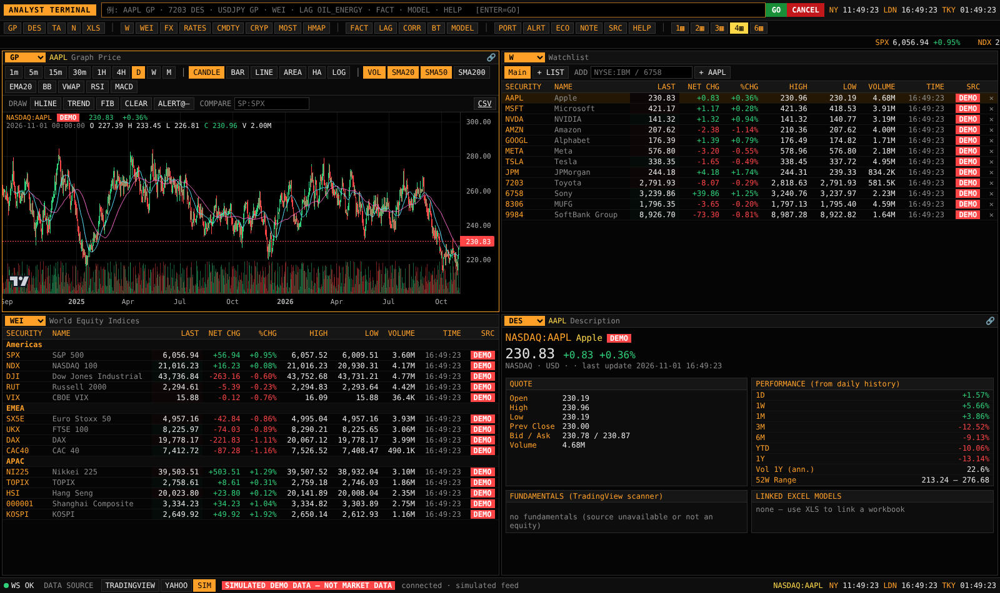

# Analyst Terminal

ヘッジファンドのアナリスト向けの、**ブルームバーグターミナル風の分析プラットフォーム**です。

- TradingView / Yahoo Finance からデータを取得します（画面から手動で切り替え可能、オフライン用の SIM モードあり）
- TradingView 型のチャート（足種、時間足、インジケーター、描画、比較）を備えています
- 分析機能：ファクター分析、タイムラグ（リード・ラグ）分析、相関、バックテスト、テクニカル判定
- **Excel 連携**：銘柄を選ぶと、紐付いた Excel モデルを劣化なく表示します。編集は本物の Excel で行い、What-if（仮の値での再計算）はブラウザで行えます
- **業績予想ハーネス**：決定的（同じ入力からは同じ結果）で、検証チェックと数値の出所の記録を備えた財務モデルエンジンです。AI のハルシネーション対策として作っています

> **引き継ぎ（ChatGPT／他の AI／人）**: まず [`docs/HANDOFF.md`](docs/HANDOFF.md) を読んでください。
> 作業ルールは [`AGENTS.md`](AGENTS.md)、これまでの経緯は [`docs/WORKLOG.md`](docs/WORKLOG.md) にあります。

## クイックスタート

```bash
scripts/setup.sh
```

```bash
scripts/start.sh
```

ブラウザで http://localhost:8000 を開きます。Windows では `scripts\setup.ps1` → `scripts\start.ps1` を実行します。

開発時（ホットリロード）は `scripts/dev.sh` を実行し、http://localhost:5173 を開きます。

データ取得元は、画面下のステータスバーにある `TRADINGVIEW / YAHOO / SIM` ボタン、または `SRC` 機能で切り替えます。
ネットワークがない環境では `TERMINAL_PROVIDER=sim` を指定してください（全画面に **DEMO** と表示されます）。

## 画面と操作（ブルームバーグ風）



画面例（SIM モード）：[リード・ラグ](docs/img/leadlag.png) · [Excel What-if](docs/img/excel.png) · [ファクター](docs/img/factor.png) · [業績予想ハーネス](docs/img/model.png)

```
[ANALYST TERMINAL][ AAPL GP <GO>                          ][GO][CANCEL]  NY 09:30 LDN 14:30 TKY 22:30
[GP][DES][TA][N][XLS] [W][WEI][FX][RATES][CMDTY][CRYP][MOST][HMAP] [FACT][LAG][CORR][BT][MODEL] ...
 SPX 6,056 +0.9%   NDX 21,015 +0.1%   NI225 ...   (ticker tape)
┌ GP  AAPL ───────────────┐┌ W  Watchlist ──────────┐
│ chart                    ││ quotes (flash on tick)  │
└──────────────────────────┘└────────────────────────┘
┌ WEI ─────────────────────┐┌ DES  AAPL ─────────────┐
└──────────────────────────┘└────────────────────────┘
 WS OK  DATA SOURCE [TRADINGVIEW][YAHOO][SIM]  connected                 NASDAQ:AAPL  clocks
```

- コマンドは `<銘柄> <機能>` の形で入力します（例：`AAPL GP`, `7203 DES`, `USDJPY GP`）。機能だけでも実行できます（例：`WEI`, `LAG oil_energy`, `FACT JP`）
- 行をクリックすると銘柄を読み込み、ダブルクリックでチャートを開きます。パネルの 📌 で、そのパネルを特定の銘柄に固定できます
- パネル配置は 1 / 2 / 3 / 4 / 6 分割から選べます
- 機能の一覧は [`docs/COMMANDS.md`](docs/COMMANDS.md) にあります

## 構成

```
backend/   FastAPI (Python)  データ取得・配信・分析・Excel・ハーネス
frontend/  React + TypeScript + Vite + lightweight-charts  (Bloomberg 風 UI)
models/    業績予想ハーネスのモデル定義 (JSON)
docs/      設計・仕様・引き継ぎ資料 (日本語)
scripts/   setup / start / dev / test
data/      実行時データ (gitignore): store.json, workbooks/
```

## テスト

```bash
scripts/test.sh
```

内容は、backend の pytest（38 件）、frontend の tsc、vitest、ビルドです。

## 注意

TradingView / Yahoo のデータ取得は**非公式エンドポイント**を使っています。各社の利用規約を確認のうえ、個人の調査用途の範囲で使ってください（[`docs/DATA_SOURCES.md`](docs/DATA_SOURCES.md)）。
未ログインの TradingView は、多くの取引所で遅延データです（画面の `D15` 表示）。
