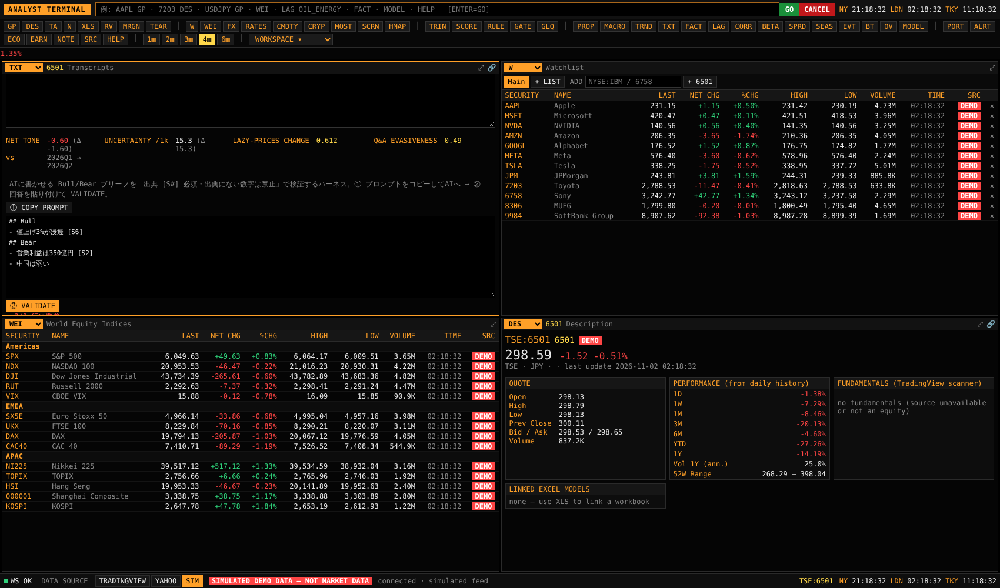

# ATTENTION & TRANSCRIPTS — 関心の伝播（TRND）と書き起こし分析（TXT）

## 1. なぜ入れたか

- **TRND**：認識伝播マップ（`PROP`）の第1段（ニッチ市場・マクロ専門家）で起きた変化が、検索や SNS の関心（第2〜3段：マクロ投資家・個人）にどこまで広がったかを測るため。「Well-known but less focused」（関門①）の判定材料です。
- **TXT**：X（Twitter）で多くの人が AI を使ってやっている分析のうち、**決定的に再現でき、出典を追える形にできるもの**だけを取り入れました。Notion 第5部の限界⑥「勝っている PM はコンセンサス改訂の方向と速度・脆弱な前提を見ている」「取材はコンセンサスの前提を理解するため」に対応します。

## 2. TRND（`/api/trends/google`, `/api/social/x`, `/api/social/stocktwits`）

| ソース | 方式 | 注意 |
|---|---|---|
| Google Trends | 非公式（`/trends/api/explore` → `widgetdata/multiline`、関連クエリは `widgetdata/relatedsearches`） | 仕様変更・429 で失敗し得る。値は期間内の最大を 100 とした相対値 |
| X API v2 | 公式。`tweets/counts/recent`（日次件数）と `tweets/search/recent`（直近 100 件） | **`X_BEARER_TOKEN`（有料プラン）が必要**。秘密情報なのでコミットしない |
| StockTwits | 公開ストリーム `streams/symbol/{ticker}`、`trending/symbols` | 米国ティッカーのみ。投稿者自身の Bullish/Bearish ラベルを集計 |

計算（`backend/app/attention.py`）
- **急騰（spike）**：最新値の、直前 12 期間に対する z スコアと、直前 4 期間平均に対する変化率。
- **関心 vs 株価**：関心の差分と株価の対数リターンを同じ日付で揃え、ラグ相関（正のラグ＝関心が先行）と両方向のグレンジャー検定。
- **SNS センチメント**：EN/JA の金融語の簡易辞書（ラベル付き投稿はそのラベルを優先）。いいね数で重み付け。

## 3. TXT（`/api/transcripts/*`）

決算説明会・スモールミーティングの書き起こし（ATLAS の文字起こしをそのまま貼れる）を期ごとに保存し、次を計算します（`backend/app/transcripts.py`、LLM は使わない）。

| 分析 | 中身 | 元ネタ |
|---|---|---|
| **Lazy Prices 差分** | 前期の書き起こしとのコサイン類似度・Jaccard、`change_score = 1 − cos`。新しく出てきた文・消えた文（文単位の最大類似度 < 0.6） | Cohen, Malloy & Nguyen (2020) "Lazy Prices"：開示文言の変化が大きい企業はその後アンダーパフォームしやすい |
| **トーン** | 肯定語・否定語・不確実性語の件数、net tone =(pos−neg)/(pos+neg)、不確実性語 / 1,000 トークン、前期比 | Loughran-McDonald 型の辞書カウント（辞書は短い自前のもの） |
| **Q&A 回避度** | 「Q:/A:」「質問：/回答：」で分割し、回答ごとに「コメントは差し控え」等の回避フレーズ、不確実性語の密度、質問との語彙の重なり、数字の有無から 0〜1 | 決算説明会の evasiveness 研究 |
| **数字の抽出** | 全ての数字（%, 億円, 百万円, bn …）を文番号 [S#] つきで抽出し、見通し・計画の文を判別 | ガイダンスの抜き出し |
| **出典必須ブリーフ（ハーネス）** | ① 文番号つきの SOURCE とルールを含むプロンプトを生成 → AI に Bull/Bear を書かせる → ② 回答を貼ると、数字を含む行に出典があるか、その数字が出典の文に実在するか、出典も「(推測)」表記もない行がないかを機械で検証 | 「AI はもっともらしい嘘をつく」問題への対策（`MODEL` のハーネスと同じ考え方） |

日本語は形態素解析をせず、漢字・かなの連続を 2 文字ずつに分けて類似度を計算しています（依存ライブラリなし・決定的）。

## 4. 取り入れなかったもの（と理由）

- 「AI に銘柄を選ばせる」「AI にスコアを付けさせてそのまま使う」：毎回結果が変わり、出典が追えない。代わりに `SCORE` に **AI Score 列**を設け、人の採点との乖離（1点以上）だけを表示する。
- 画像（チャート）を AI に読ませるテクニカル予測：再現性がなく、`TA`・`BT` で足りる。
- SNS の感情だけで売買するシグナル：`TRND` は「関心がどの段まで広がったか」の確認に限定。

## 5. 今後の候補

- 書き起こしの話者分離（CEO/CFO/アナリスト）と、ガイダンス数値の期をまたいだ追跡（前回の「計画」→今回の「実績」）。
- 有報・決算短信の差分（Lazy Prices の本来の対象）を EDINET から取得。
- サプライチェーン伝播マップ（顧客・仕入先の決算書き起こしから自社 KPI への先行関係）。
