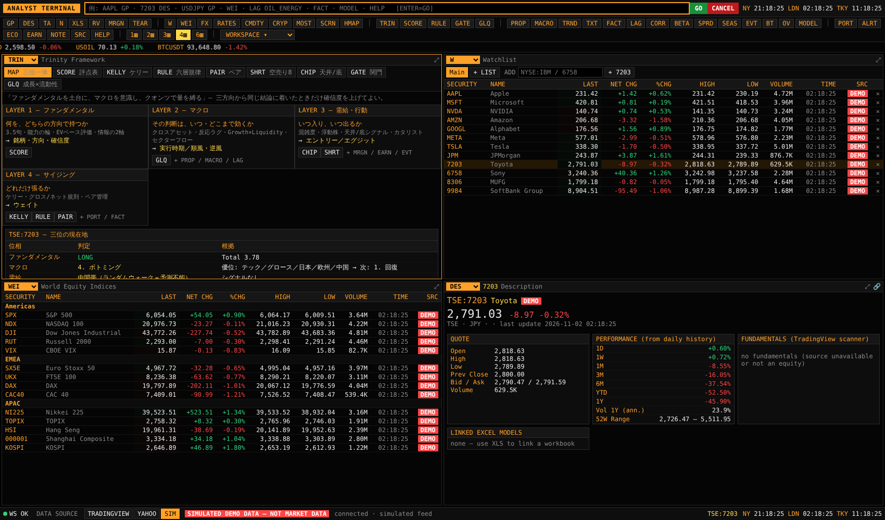
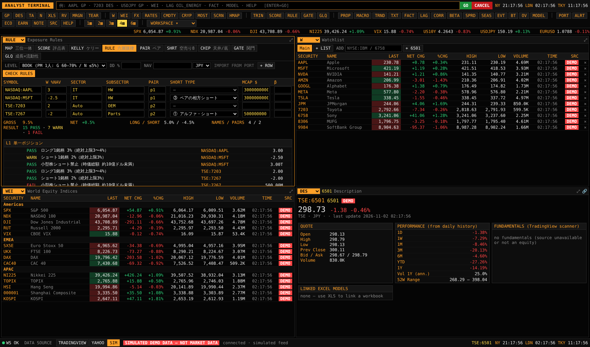
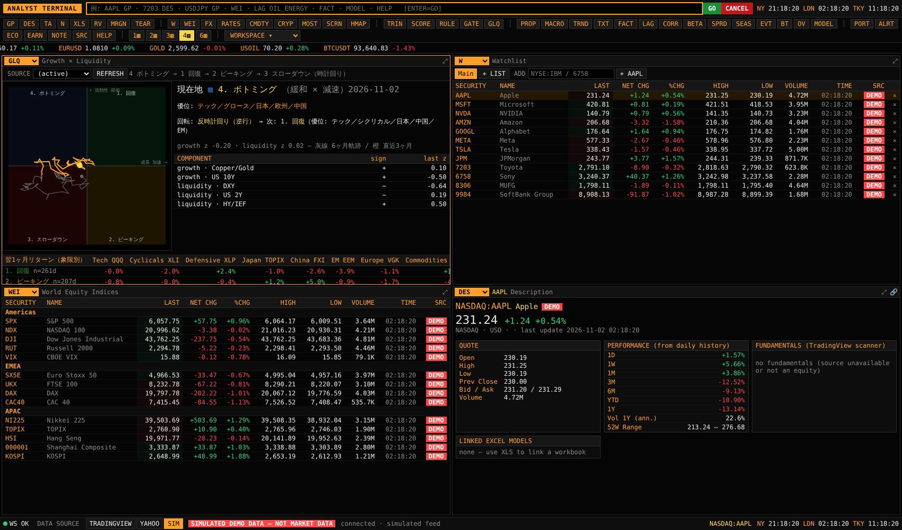
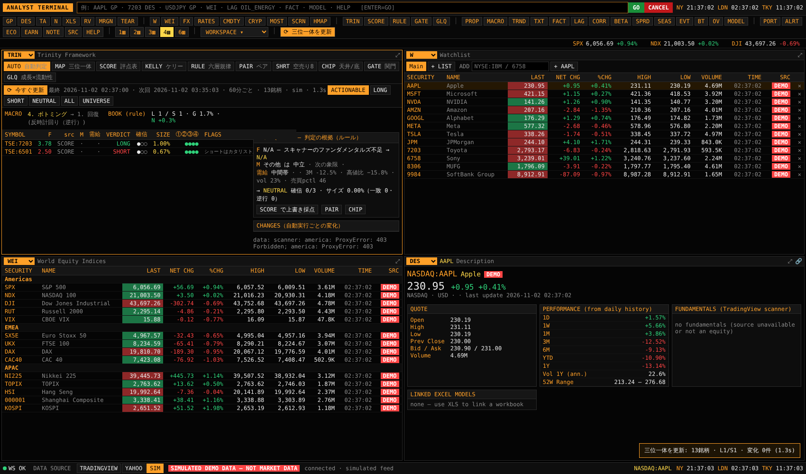

# FRAMEWORK — 投資の三位一体（ユーザーと Pinpoint のフレームワーク）をターミナルに落とし込む

出典：ユーザーの Notion `ATLAS / STRATEGY / 投資の三位一体 — マクロ × ファンダメンタル × クオンツ`（全5部）と、その元になった `ファンダメンタル戦略`・`Framework of Pinpoint`・`見るべき統計`。
（ページ ID：三位一体 `30321d2e54e34dce957dd40680860877`、第1部 `a26aa4fd7bd04e038bb2501e240a5e39`、第2部 `32b6da69fc094dc3b86f62293fb598ef`、第3部 `9d7242cb99a944ba871356e2707d1917`、第4部 `b1d7dd1c71ea473792125c0e910fb6a5`、第5部 `24b0ea37a2744805aab56aa8b3d1f752`）

このファイルの目的は2つです。

1. **フレームワークを構造として読めるようにする**（§1〜§3）。何を前提に、どの層で、どの数字を使って判断しているか。
2. **そのフレームワークどおりに分析できるようにする**（§4〜§6）。どの判断をどのコマンドで、どのデータから、どの規則で出しているか。数字は Notion の値をそのまま使い、Notion に数字がない箇所は「プレースホルダー」と明記しています（§7）。

---

## 1. 一文でいうと

> **ファンダメンタルを土台に、マクロを意識し、クオンツで量を縛る。**
> マクロから抽出したテーマを、日本個別株市場の「リアクション・タイムラグ」で収益化するロング／ショート（マーケットニュートラル）。
> **三方向から同じ結論に着いたときだけ、確信度を上げてよい。**

- 単一銘柄リターンの 80〜90% はマクロ（マーケットβ 40–50%、スタイル 25–30%、セクター 15–20%）。個別固有は約 10%。アルファを取りに行くのはこの 10%で、上の 3 層は「意図せず抱えていないか点検する対象」。
- 自分のエッジは アルファ 4 源泉のうち **(D) 情報・分析の優位**。(D) は「収束までの時間リスク」を構造的に解いていない唯一の源泉なので、**カタリスト管理とドローダウン規律が死活問題**になる。
- マクロは「何を買うか」を決める層ではなく、「自分の銘柄判断が上書きされていないか」を検知する層。**意識するが、乗り換えない。**

## 2. 構造（5部 → 4層パイプライン → 5関門）

| 部 | 問い | 道具（Notion） | 出力 |
|---|---|---|---|
| 第1部 前提 | 市場と人間に何を仮定するか | 4つの前提→3つの推論→**採点ルール**（1〜5点、3.4以上ロング／2.7以下ショート）、リターン分解、アルファ4源泉 | 三位に分ける根拠 |
| 第2部 ファンダメンタル（土台） | 何を、どの銘柄で、どちらの方向で持つか | **3.5句**、能力の輪、三大原則、Sカーブ、BS＞CF＞PL、EVベース評価、**評点表**、個別の需給 | 銘柄・方向・確信度 |
| 第3部 マクロ（意識する層） | その判断はいつ・どこまで効くか | **反応ラグ（3段・②→③で入る）**、Theme Alpha（3–12M）／Market Timing（1–3M）、**成長×流動性 4象限**、セクターフロー、資金・チップ（天井/底） | 実行時期・順風／逆風 |
| 第4部 クオンツ（量を縛る層） | どれだけ張り、どう守るか | **期待値・ケリー F=E/(XW×XL)**・六つの原則、**六層のエクスポージャー規律**、Pair Sigma、空売り8モデル、リスク4分類 | ウェイト |
| 第5部 一体運用 | 三位をどう束ねるか | 一致点、**衝突時の裁定ルール**、**関門①〜⑤**、四半期点検Ⅰ〜Ⅳ、限界①〜⑥、3エンジン | 毎月ゼロから作り直す回路 |

### 意思決定パイプライン（05.2）

```
LAYER 1 ファンダメンタル ─→ LAYER 2 マクロ ─→ LAYER 3 需給・行動 ─→ LAYER 4 サイジング
 3.5句・能力の輪・EV評価     反応ラグ・4象限・フロー   混雑度・天井/底・カタリスト   ケリー・グロス/ネット・ペア
 → 銘柄・方向・確信度         → 実行時期・順風/逆風      → エントリー／エグジット      → ウェイト
```
- Theme Alpha（3–12ヶ月）は LAYER 1→2 が中心。Market Timing（1–3ヶ月）は LAYER 2→3 が中心。

### 三位が同じことを言っている箇所（01.6 / 05.1）

| マクロ軸 | ファンダメンタル軸 | クオンツ軸 |
|---|---|---|
| Crowded Theme を避ける | 混雑度＝機関保有比率／保有金額÷1日売買代金 | 空売りモデル①の第4条件（過度な混雑） |
| 反応ラグの第②→③段で入る | 情報が「事実にも同業にも」先行しているか | — |
| テーマ・バスケット | — | ペアをテーマ単位に拡張したもの |

## 3. 主要な数字（Notion の値）

| 項目 | 値 | 出典 |
|---|---|---|
| 採点 | 全社 1〜5 点。**≥3.4〜3.5 ロング／≤2.6〜2.7 ショート**。予測不能（約60%）は3点前後 | 01.1 |
| 3.5句のウェイト | 独占・NW効果 1／コスト・コスパ 1／ブランド 1／技術 0.5 | 02.1 |
| 評点差→サイズ | 差 0.5 → 0.5%×0.5%、差 1.2 → 2% | 02.4（スズキ例） |
| ケリー | E = PW·XW − PL·XL、F = E/(XW×XL)、G = PW·ln(1+F·XW) + PL·ln(1−F·XL) | 04.2 |
| L1 単一 | ロング 3%（絶対3〜4%）、ショート 2%（絶対3%）、小型株ショート禁止（時価総額 約10億ドル） | 04.3 |
| L2 ペア | Pair Sigma 25〜30%未満（理想10%）、Pair Correlation 高いほど良い、Beta調整後 Net÷Gross 30%未満（超過は最大3ペア）、同一サブセクター | 04.3 |
| L3 / L4 | サブセクター・ネット ±3%、セクター・ネット ±5% | 04.3 |
| L5 ブック | グロス 60〜70%、ネット ≤5%、40〜80銘柄、30〜40ペア、DD 上限 約5%（−5% でグロス半減） | 04.3 / 05.5 |
| L6 ファンド | グロス 150〜300%、ネット −10〜+10%、単一 ±5%（GMV比）、目標Vol 10〜12%、目標リターン 15〜20% | 04.3 |
| アルファ・ショート | 最低 30〜40% の下落見込み。ショートはカタリスト必須 | 04.5 / 02.4 |
| 空売り①増速放緩 | 自社ヒストリカルで 90〜95 パーセンタイル以上＋将来1〜2年の利益予測＋増速鈍化（二階微分が負）＋過度な混雑の **4条件すべて** | 04.5 |
| 空売り③無利潤の成長 | 増速 50% 未満 または Rule of 40 < 40、かつ CF マイナス | 04.5 |
| 天井 | 回転率が持続的に高い（市場全体 70%×1か月、個別 10%×1か月）／絶対的な過大評価／信用買い残が大きい | 03.5 |
| 底 | 回転率が極めて低い／配当利回りが高い／資金流出が止まる | 03.5 |
| ペア適性 | 相関 < 0.5 が維持されるペアがあるか／決算サプライズの非同期性／固有分散比率 ≥30%／貸株 | 05.4 |
| エントリー | 直近20日のスプレッドが上位20%以上の拡大局面ではエントリーしない | 05.4 |
| スプレッド4分類 | A-1（ファンダ起因×事前予測可能）だけがアルファ | 05.3 |
| 成長×流動性 | 時計回り 4 ボトミング → 1 回復 → 2 ピーキング → 3 スローダウン。直近3ヶ月クローズアップ、6ヶ月軌跡を毎日更新 | 03.4 |

## 4. フレームワーク → ターミナルの対応表

| フレームワークの要素 | コマンド | 何が自動で、何が手入力か |
|---|---|---|
| パイプライン全体・三位の一致・裁定ルール | **`TRIN`**（MAP タブ） | 読み込み中の銘柄について、最新の評点表（ファンダ）、成長×流動性の現在地（マクロ）、天井/底シグナル（需給）を1画面に並べる |
| 評点表（Weight／Score／AI Score／Previous Score → Total、Direction、Reason）＋3.5句 | **`SCORE`** | 採点は手入力。合計・方向・長期/短期の内訳・AI との乖離・前回比は自動。保存するたびに版を残し、Previous Score は前版から自動で入る。「3.5句合致企業のショート」「ショートにカタリストなし」「取引可能な命題が空」を警告 |
| 評点の更新結果としてのロング／ショート候補（リサーチ5ステップの STEP 3） | `SCORE` の COVERAGE、`KELLY` のペア候補 | 保存済み評点表をスコア順に並べ、同じサブセクターの最高×最低をペア候補にし、評点差→サイズを計算 |
| 期待値・ケリー・六つの原則 | **`KELLY`** | PW／XW／XL を入力 → E、F、G、成長曲線、推奨ウェイト（既定 1/2 Kelly、L1 上限で頭打ち）、原則ごとの判定 |
| 六層のエクスポージャー規律 | **`RULE`** | PORT から重みを取り込み（NAV と FX 換算）、セクター・時価総額・βはスキャナーから補完。ペアごとに Pair Sigma・相関・β調整Net÷Gross を価格から計算。L1〜L6 と DD ルールを PASS/WARN/FAIL で表示 |
| ペア管理の3指標・ペア適性・A-1 宣言・20日エントリールール | **`PAIR`** | 価格から Pair Sigma（21日、年率）、60日相関とその分布、β、固有分散比率、20日スプレッドのパーセンタイルを計算。決算の非同期性・貸株・スプレッド分類は手入力。Notion のサブセクター適性表を併記 |
| 空売り8モデル・4つの型 | **`SHRT`** | 高値からの下落、出来高トレンド、時価総額（USD）、売上成長、営業利益率、FCF、3.5句（SCORE から）を自動取得。残りは手入力。不明な条件は「不明」のまま（推測で埋めない） |
| 天井・底シグナル、混雑度 | **`CHIP`** | 回転率（出来高÷浮動株）、信用倍率のパーセンタイルと買残÷出来高（`MRGN` に取り込んだ JPX データ）、配当利回り − 10年金利。混雑度は保有金額と機関保有比率を入力すると計算 |
| 関門①〜⑤・四半期点検Ⅰ〜Ⅳ・毎月リセット | **`GATE`** | アイデアごとに各項目を YES／NO／NA で通過させる。全項目 YES/NA で初めて「ポジション成立」。MONTHLY RESET で今月分をアーカイブし回答を消す（「エントリー価格と含み損益を忘れ、ゼロから作り直す」） |
| 成長×流動性 4象限 | **`GLQ`**（`MACRO` にも表示） | 市場データの代理指標で現在地・6ヶ月軌跡・回転方向・次の象限・象限別の翌月リターンを計算（§7 の注意） |
| 反応ラグ（ニッチ→マクロ投資家→日本株）・未波及 | `PROP`、`LAG` | 認識伝播マップ（資産クラス×段）、段間のラグ相関、未波及の検出 |
| セクター・フロー／価格モメンタム | `FACT`（セクターローテーション）、`HMAP` | 海外勢のセクター別フロー統計そのものは未取得（ROADMAP） |
| 個別の需給（信用残） | `MRGN` | JPX 週次の銘柄別信用残を取り込み |
| カタリスト（決算・イベント） | `EARN`、`EVT`、`ECO` | |
| コンセンサス改訂・取材の使い方（限界⑥） | `TXT` | 決算説明会の書き起こしの言語変化（Lazy Prices）、トーン、Q&A の回避度、数字の抽出（出典つき） |
| AI 活用（第1部「AIエージェント」） | `TXT` の BRIEF、`MODEL` の AI ブリーフ | AI に書かせる文章は「出典 [S#] 必須・出典にない数字は禁止」を機械で検証する |
| 20+ファクターで意図しないベットを検知 | `FACT`、`PORT` の RISK | 20+ ファクターの社内モデルそのものは無い（市場β・スタイル ETF の近似） |







## 5. 使い方（Notion の運用リズムに合わせて）

**毎日（⑤継続監視）**
1. `GLQ` で象限と回転方向、`PROP` で第1段の変化と未波及を確認（Market Timing の一次シグナル）。
2. `RULE` → CHECK RULES（ファクター・エクスポージャーの再計算に相当）。FAIL があれば先に直す。
3. 取材・決算のインプットを `SCORE` に反映し、版を保存（リサーチ5ステップの STEP 2〜3）。決算説明会は `TXT` に貼り付けて前回との差分を見る。

**新しいアイデア**
1. `GATE` にアイデアを登録 → ① マクロ関門（`GLQ`・`PROP`・`LAG`）。
2. ② ファンダメンタル関門：`SCORE`（3.5句・取引可能な命題・他の投資家の見方）。
3. ③ 需給・行動関門：`CHIP`・`MRGN`・`EARN`、ショートなら `SHRT`。
4. ④ サイジング関門：`KELLY`（E>0、F、上限）→ `PAIR`（Pair Sigma、同一サブセクター、A-1、20日ルール）→ `RULE`。
5. すべて YES/NA になったらポジション成立。

**毎月**：`GATE` の MONTHLY RESET。`SCORE` を白紙の気持ちで更新（前版は Previous Score として残る）。

**四半期**：`GATE` の Ⅰ〜Ⅳ。`TXT` の変化スコアの履歴、`PAIR` の A-1 比率を見直す。

## 6. 裁定ルール（05.2）— ターミナル上の扱い

| 衝突 | 裁定 | 実装 |
|---|---|---|
| 3.5句合致企業がテーマ的にショート候補 | 哲学側を優先。TOPIX先物／大型低ボラでヘッジ | `SCORE` と `SHRT` が警告を出す |
| ファンダ良好だがクラウデッド | Market Timing に限定し 1〜3ヶ月、大型・低ボラ | `CHIP` の混雑度、`RULE` の「ペア相方は大型」 |
| マクロ弱気だが期待値は正 | ネットをフラットに保ったままペアで持つ | `RULE` のネット規則、`KELLY` の原則1 |
| 確信度は高いが分散も大きい | 確信度はグロスを、分散はウェイトを決める | `KELLY`（原則4・5）と `score_gap_size` |

## 7. 前提・解釈・未実装（必ず読む）

- **評点表の各 Weight は Notion に数値がない**（「配点あり・合計100」のみ）。初期値はプレースホルダー（ガバナンス 4×5、競争力 2×10、短期 10/10/10/5、バリュエーション 7/5/8、その他 5）。画面上で自分の配点に書き換えて保存してください。
- **評点差→サイズ**は Notion の2点（差0.5→0.5%、差1.2→2%）の線形補間で、それ以外の点は推定です。
- **回転率の閾値の解釈**：Notion は「市場全体 70%×1か月、個別 10%×1か月」。個別は「1日平均回転率 10% が1か月（20営業日）続く」、市場全体は「20営業日の累計 70%」と解釈しています（画面で変更可）。浮動株はスキャナーの値で、取れない場合は手入力。
- **成長×流動性の指標はユーザー独自の指標ではありません**。市場データの代理指標です：成長＝銅/金と米10年金利の3ヶ月変化、流動性＝−ドル指数・−米2年金利・HY/IEF の3ヶ月変化。各成分を過去3年で z 化して平均（`backend/app/macro.py` の `GL_INPUTS` で変更可）。独自指標の定義が分かれば置き換えます。
- **Pair Sigma** は「前日引けのペアを過去1ヶ月保有した想定の年率ボラ」を、ペアのグロスで正規化した日次リターンの21日標準偏差 ×√252 で近似しています。
- **固有分散比率**は市場1ファクター（日本株は TOPIX、米国株は S&P 500）に対する 1−R² の近似です。社内の 20+ ファクターモデルではありません。
- **空売りモデル**の「自社ヒストリカルのバリュエーション・パーセンタイル」「混雑度パーセンタイル」「格下げ比率」は、現在のデータソースでは取得できないため手入力です。
- **未実装**：セクター別の海外勢フロー（Notion の「セクター・ファンドフロー・モニター」）、政策保有株の売却リスト（エンジン1、有報の解析）、コンセンサス改訂モメンタム（推定値の時系列）、貸株コスト、METI 生産動態・SCFI などの統計の自動取得 → ROADMAP。

## 8. AUTO — ルールベースで自動更新する三位一体（`TRIN` の既定タブ）

手入力なし・AI なしで、カバレッジ全銘柄の三位一体を一定間隔で自動計算します（`backend/app/trinity_auto.py`、`api_trinity.py`）。

- **対象**：ウォッチリスト ＋ SCORE を保存した銘柄 ＋ PORT のポジション ＋ 追加指定（UNIVERSE で設定）。指数・為替・先物・暗号資産は除外。
- **頻度**：起動の約20秒後と、その後 `interval_min`（既定60分）ごと。**手動更新**：上部バーの「⟳ 三位一体を更新」（どの画面からでも）または AUTO タブの「⟳ 今すぐ更新」。結果は `data/trinity/`（latest、日次の履歴、変化のログ）に保存し、判定が変わるとブラウザに通知（トースト）。
- **F（ファンダメンタル）**：評点表があればそれを使う（人の判断を優先）。なければスキャナーのファンダメンタルズを同じユニバース内で順位付けする**ルール採点**：質 35%（ROE・営業利益率・粗利率）、成長 25%（売上成長）、割安 25%（EV/EBITDA・PER、赤字は最下位）、安全性 15%（D/E、FCF マイナスは0）。合成パーセンタイル p を Notion の分布（約6割は3点前後、明確な乖離は約2割）に合わせて 1〜5 点に写す：p ≤ 10% → 1.0〜2.6、10〜90% → 2.75〜3.35、≥ 90% → 3.4〜5.0。比較できる銘柄が5未満なら N/A。
- **M（マクロ）**：成長×流動性の現在の象限で、銘柄のセクターが優位か逆風か（03.4 の優位アセット。ピーキングでは高ベータも優位）。
- **需給**：天井/底シグナル（回転率または出来高の自己パーセンタイル、信用倍率、配当利回り）と混雑（売買が上位10%かつ52週高値から5%以内）。天井寄り＝−1、底寄り＝+1。
- **判定**：F が無ければ NEUTRAL（マクロだけでポジションは作らない）。確信度 = 1 + 一致数 − 逆行数（0〜3）。三方向一致で 3。
- **サイズ**：上限（ロング 3%／ショート 2%）× 確信度/3 × min(1, 30% ÷ 年率ボラ)。3.5句合致企業のショートと小型株ショートは 0（裁定ルール）。
- **自動関門**：①マクロが逆風でない ②F に方向がある ③需給が逆向きでない ④サイズ > 0。
- **空売りモデル**：データから判定できるもの（②基金放棄、③無利潤の成長など）を自動判定。



注意：スキャナー（TradingView）が使えない環境では F のルール採点は N/A になり、評点表を保存した銘柄だけが判定されます。

## 9. 分析の拡張（ルールベース、AUTO にも反映）

| Notion の要素 | コマンド | ルール |
|---|---|---|
| 01.2 リターン分解（マーケット 40–50 / スタイル 25–30 / セクター 15–20 / 個別 ≈10%）、04.4「20+ファクターで意図しないベットを検知」 | **`XRAY`** | 日次リターンを マーケット → スタイル・マクロ（為替・金利・原油・銅・半導体・中国・スタイル ETF）→ セクター ETF の順に回帰し、R² の増分を各層の寄与とする（階層分解）。ブックでは露出 = Σ w·β、分散寄与（オイラー分解）。単一因子 > 20%、マーケット露出 > 5%、個別由来 < 50% で警告 |
| 03.4 セクター・ファンドフロー・モニター（海外勢フローの代理） | **`RRG`** | JdK RRG の公開近似（z スコア版、週次）。TOPIX-17 業種 ETF・米国セクター ETF・カバレッジ。売買代金比（4週 ÷ 52週）と上昇週の比率で「資金流入／流出」 |
| 03.3・03.6 テーマ（事実 → 理由 → バスケット）、03.2 反応ラグ、限界④ バスケット買い | **`THEME`** | β中立スプレッドの z とドライバー z からフェーズを判定（②→③ エントリーゾーン＝ドライバー z ≥ 1 かつスプレッド z < 0.5）。銘柄間の平均相関が過去1年の上位20%かつ 0.5 以上で「バスケット買い支配」。Notion の5テーマをテンプレート化（構成は TOPIX-17 業種 ETF による代用） |
| 04.3 ペア管理、05.4 ペアの適性 | **`PFND`** | サブセクター内の全ペアを評価。ロング＝評点の高い側。PASS = Pair Sigma < 25% かつ β調整 Net÷Gross < 30%。20日スプレッド上位20%は「待」 |
| 04.1 ベイズ推理、04.2 ケリー、05.6 Ⅲ 損益の形、目標勝率（週 68%／月 76%／年 90%） | **`TRAK`** | BLOTTER の約定から往復取引を作り、勝率を Beta 分布で更新（事前 Beta(1,1)）。平均勝ち／負け率 → E・ケリー（推奨は min(½F, 3%)）。歪度で保険売り型／凸性購入型（10 取引以上）。→ KELLY ボタンで実績を KELLY に入力 |

AUTO への反映：各銘柄に **SECT**（セクター ETF の RRG 象限。劣後のロング／主導のショートは関門①を FAIL）、**固有**（XRAY の個別固有の比率。30% 未満は「ペア／ヘッジで持つ」の警告）、**決算**（次回決算までの日数。ショートのカタリスト）を追加。保存したテーマは毎回再計算し、フェーズが変わると通知。

## 10. コード

| ファイル | 内容 |
|---|---|
| `backend/app/xray.py`, `rrg.py`, `themes.py`, `pairscreen.py`, `trackrecord.py`, `api_insight.py` | XRAY / RRG / THEME / PFND / TRAK（`/api/insight/*`） |
| `backend/app/trinity_auto.py`, `api_trinity.py` | AUTO（ルール採点・判定・差分、スケジューラ、`/api/trinity/*`） |
| `backend/app/framework.py` | 評点表・3.5句・評点差→サイズ・ケリー・六層チェック・ペア指標と適性・空売り8モデル・天井/底・混雑度・関門（純関数、決定的） |
| `backend/app/api_framework.py` | `/api/framework/*`（[API.md](API.md)） |
| `backend/app/macro.py` | `growth_liquidity`（成長×流動性）、`GL_INPUTS` |
| `backend/app/transcripts.py` | 書き起こしのトーン・差分・回避度・数字・出典検証 |
| `frontend/src/functions/Trinity.tsx` | `TRIN` とタブ（SCORE / KELLY / RULE / PAIR / SHRT / CHIP / GATE / GLQ） |
| `backend/tests/test_framework.py` | Notion の数字（3.4/2.7、差0.5→0.5%、L1〜L6、4条件など）を再現するテスト |
